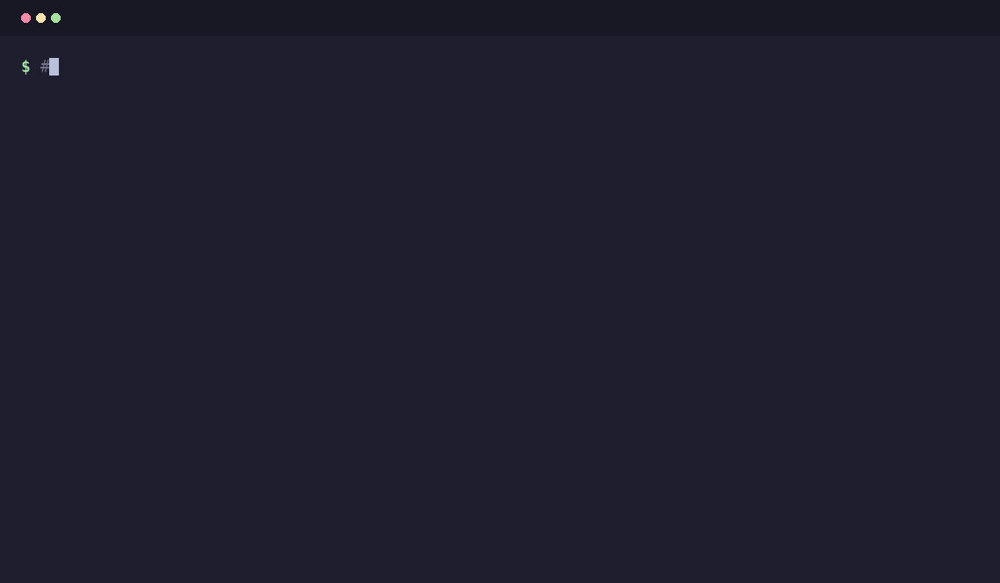

# pg_integrity_checksums - Multi-Level Data Integrity Extension for PostgreSQL

[](https://github.com/VictorNagibator/pg_integrity_checksums/actions/workflows/ci.yml)
[](https://github.com/VictorNagibator/pg_integrity_checksums/actions/workflows/quality.yml)
[](https://github.com/VictorNagibator/pg_integrity_checksums/actions/workflows/codeql.yml)
[](https://codecov.io/gh/VictorNagibator/pg_integrity_checksums)
[](https://scorecard.dev/viewer/?uri=github.com/VictorNagibator/pg_integrity_checksums)
[](https://www.bestpractices.dev/projects/16732)

[](https://github.com/VictorNagibator/pg_integrity_checksums/releases/latest)
[](https://github.com/VictorNagibator/pg_integrity_checksums/releases?q=cli-v)
[](https://pgxn.org/dist/pg_integrity_checksums/)
[](https://pgext.cloud/ext/pg_integrity_checksums)
[](https://github.com/VictorNagibator/pg_integrity_checksums/pkgs/container/pg_integrity_checksums)
[](https://www.postgresql.org/)
[](https://victornagibator.github.io/pg_integrity_checksums/)
[](LICENSE)

**Verify that a replica, a restored backup or a migrated database holds
exactly the same data as the source, without relying on physical layout.**



Logical checksums ignore how the data is stored: they stay the same after
`pg_dump`/restore, VACUUM FULL, REINDEX, a logical replica or a move to a
server with a different OS or CPU architecture.  When they do not match, row
and key-bucket checksums narrow the difference down to the rows (for large
tables compare buckets first, see
[Finding differing rows](docs/functions.md#finding-differing-rows)), and the
companion CLI automates all of it for CI.  The recording is reproducible, see
[`demo/`](demo/README.md).

## Overview

pg_integrity_checksums provides cell, tuple, table, index and database
checksums.  Cell checksums are logical; tuple, table, index and database
checksums support both physical and logical modes.

Logical checksums are canonical across endianness, VACUUM/REINDEX/physical
movement and database OIDs.  Physical checksums are for on-disk corruption in
one specific cluster.

The default SQL API uses FNV-1a 32-bit and returns ordinary SQL integers:

```sql
SELECT pg_table_logical_checksum('public.orders'::regclass);
SELECT pg_table_physical_checksum('public.orders'::regclass, false);
```

When two copies of a table differ, the logical checksum can be split by key
bucket (or, on a physical standby, by block range) to find the rows that
differ; see [Finding differing rows](docs/functions.md#finding-differing-rows).

A generic API with an explicit algorithm (FNV-1a 32/64-bit, CRC-32C or
XXH3-64) returns raw `bytea` digests, for a wider or faster checksum.  It is described in the
[function reference](docs/functions.md).

## Quick start

```sql
CREATE EXTENSION pg_integrity_checksums;
SELECT pg_table_logical_checksum('public.orders'::regclass);
```

Install it with any of these ([details](docs/installation.md)):

```bash
pgxn install pg_integrity_checksums                     # PGXN
sudo apt install postgresql-16-pg-integrity-checksums   # PIGSTY APT repository
docker run -e POSTGRES_PASSWORD=secret \
  ghcr.io/victornagibator/pg_integrity_checksums:pg16   # image with the extension

git clone https://github.com/VictorNagibator/pg_integrity_checksums.git
cd pg_integrity_checksums && make && sudo make install  # from source (PGXS)
```

The companion CLI captures baselines and verifies a database against them,
with text, JSON and JUnit reports for CI.  Download a
[release binary](https://github.com/VictorNagibator/pg_integrity_checksums/releases?q=cli-v)
or use the `ghcr.io/victornagibator/pg_integrity_checksums-cli` image (see
[CLI installation](docs/cli.md#installation)), then:

```bash
pg_integrity_checksums capture --db "$DATABASE_URL" --output baseline.json
pg_integrity_checksums verify --db "$DATABASE_URL" --baseline baseline.json
```

The CLI uses the 32-bit v1 baseline format by default.  Add
`--hash fnv64` to `capture` when you explicitly need a 64-bit v2 baseline.

## Use cases

- **After a major-version upgrade or a migration.** Compute
  `pg_database_logical_checksum` (or `capture` a baseline with the CLI)
  before, and compare it with the value on the new cluster.  It holds across
  `pg_upgrade`, `pg_dump`/restore and a move to another OS or CPU architecture.
- **Logical replication and replicas.** Compare a table on the publisher and
  the subscriber.  If they differ, split the checksum by key bucket to find the
  rows, see [Finding differing rows](docs/functions.md#finding-differing-rows).
- **Restored backups in CI.** Capture a baseline when the backup is taken, then
  `verify` it against the restored database and fail the job on a mismatch; the
  CLI writes JUnit reports and ships as a GitHub Action.
- **Detecting corruption.** Physical checksums validate page and tuple
  structure while they hash, so a damaged page fails the call instead of
  producing a value.

```sql
-- on the source, then on the copy: the values must be equal
SELECT pg_table_logical_checksum('public.orders'::regclass);
```

## How is this different from pg_checksums, amcheck or pg_comparator?

They answer different questions, and work well together:

| | pg_integrity_checksums | `pg_checksums` / `data_checksums` | `amcheck` | `pg_comparator` |
|---|---|---|---|---|
| Answers | Do two copies hold the same data? | Is a page damaged on disk? | Are a table and its indexes structurally valid? | Which rows differ between two tables? |
| Compares two databases | yes, live or against a saved baseline | no | no | yes, both online at once |
| Unaffected by dump/restore, VACUUM FULL, CPU architecture | yes (logical mode) | — | — | yes |
| Runs on a live server | yes, in one MVCC snapshot | `data_checksums` on read; the `pg_checksums` tool needs a stopped cluster | yes | yes |
| Finds the differing rows | yes, by key buckets, no primary key needed | — | — | yes, needs a primary key, and can sync them |

PostgreSQL's page checksums and `amcheck` catch corruption inside one cluster,
but a restored backup that is missing rows, or a replica that diverged, passes
both.  This extension catches that, and keeps the result as a value you can
store and compare later.  See [Compared with other tools](docs/concepts.md#compared-with-other-tools).

## Errors and skipped relations

Database-level checksums are **strict by default** (since 2.5): if a relation
cannot be checksummed (an invalid index, a corrupt page, an unlogged table on a
standby), the call fails and names the relation, instead of returning a value
that silently leaves it out.  `SET pg_integrity_checksums.strict = off` skips
such relations with a warning; do not use that value for monitoring.  See
[Strict mode](docs/operations.md#strict-mode).

## Documentation

- [Documentation site](https://victornagibator.github.io/pg_integrity_checksums/)
- [Getting started](docs/getting-started.md)
- [Installation](docs/installation.md)
- [Upgrading](docs/upgrading.md)
- [Concepts](docs/concepts.md)
- [Function reference](docs/functions.md)
- [Architecture](docs/architecture.md)
- [CLI documentation](docs/cli.md)
- [Operations](docs/operations.md)
- [Benchmarks](docs/benchmarks.md)
- [Testing and releases](docs/testing.md)
- [Troubleshooting](docs/troubleshooting.md)
- [CLI changelog](cli/Changes)
- [Extension changelog](Changes)
- [Migration from 1.x](MIGRATION.md)

## Compatibility

The 32-bit numeric SQL functions are the default and remain fully supported,
as are v1 baselines.  The optional generic API adds explicit `fnv32`/`fnv64`/`crc32c`/`xxh3`
digests and v2 baselines; see [Functions and algorithms](docs/functions.md)
and [Concepts](docs/concepts.md) for selection guidance.

## Support

- [Contributing](CONTRIBUTING.md)
- [Security policy](SECURITY.md)
- [Code of Conduct](CODE_OF_CONDUCT.md)
- [License](LICENSE)
